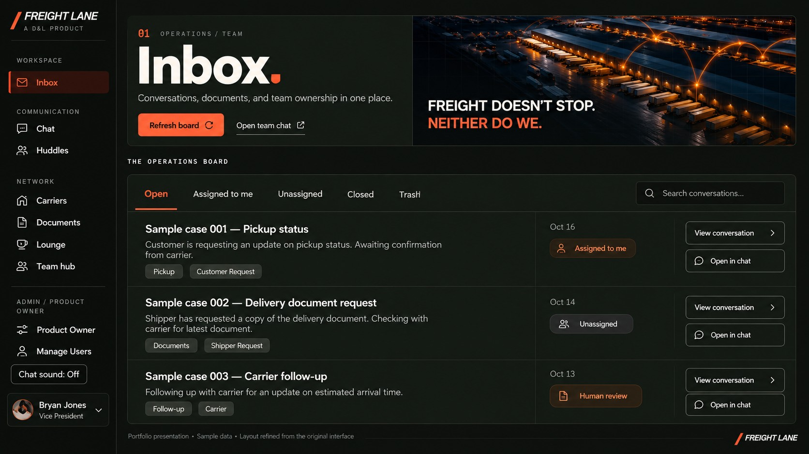
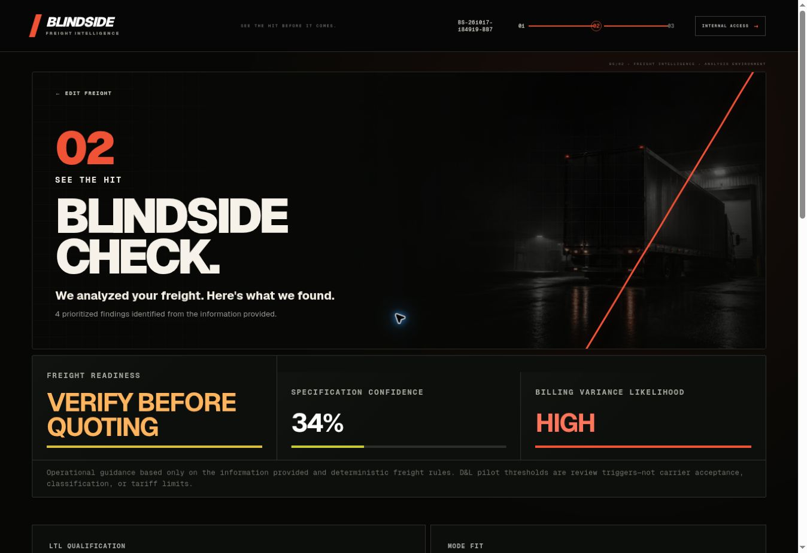
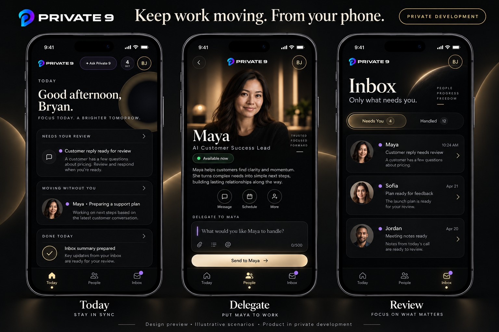

# Bryan Jones
### Operations leader. AI product creator.

**I turn firsthand business problems into tools teams can use.**

I built the operations department I lead and took that same approach into creating software: understand the work, decide what needs to change, and stay with it through testing and adoption.

My work covers product strategy, workflow design, AI-assisted implementation, and the decisions that keep people in control.

**[Explore my portfolio and interactive demos →](https://bryan-jones-product-portfolio.khemnxops.chatgpt.site)**

---

## Selected work

### Freight Lane
**A shared workspace for the team and the work · Used daily**

*Refined portfolio presentation with sample data; the live interface differs.*

**The problem:** Shipment requests, documents, carrier updates, and team conversations were scattered. People had to reconstruct the same context to understand a case.

**My decision:** Bring operations and collaboration together. Automating email alone would still leave the team switching between tools.

**What I created:** A shared inbox, shipment cases, document intelligence, team chat, video huddles, and owner controls. A person can claim a case, pause AI activity, edit a proposed reply, and decide when execution resumes.

**My role and result:** I conceived the product, designed the workflows, directed AI-assisted implementation, tested real requests, and led rollout. Our four-person department uses it daily. Ongoing improvements have addressed instruction accuracy, document handling, and duplicate handling.

### BlindSide
**Check the details before the shipment moves · Used on demand by 20–30 freight agents**

*Actual application screenshot from a sample shipment. The displayed scores describe that example.*

**The problem:** Incomplete shipment details can lead to billing adjustments, with too little evidence available when a carrier questions the original quote.

**My decision:** Move the review earlier and pair each meaningful warning with something the agent can verify or document.

**What I created:** A three-step experience: enter the freight details, review the findings, and prepare a defensive play. It helps agents identify facts to confirm and evidence to preserve, with shareable summaries and PDF reports.

**My role and result:** I identified the problem, shaped the mobile experience and branding, and directed AI-assisted development, testing, and rollout. BlindSide is used on demand by 20–30 agents. It supports preparation; it does not guarantee carrier acceptance or billing outcomes.

### Private 9
**Keep work moving from your phone · Private development**

*Design preview with illustrative scenarios, not a screenshot of completed live functionality.*

**The problem:** Owners need to delegate and make decisions without spending the day checking separate tools.

**My decision:** Center the mobile experience on Today, People, and Inbox. Give the owner a clear place to see what needs attention, assign work, and review the outcome.

**My role and progress:** I defined the product vision, designed the mobile workflows and human/AI teammate experience, and directed AI-assisted implementation and testing. The product remains in private development, with integration setup and further verification still underway.

---

## What I bring to a project

- **Business understanding:** Find the actual bottleneck and define a useful, manageable scope.
- **Product direction:** Turn a rough idea into requirements, workflows, and a usable experience.
- **Practical AI:** Define when AI can act, when approval is needed, and how a person takes over.
- **Follow-through:** Test real scenarios, support rollout, and improve the product from feedback.

### Tools used in my product work
ChatGPT / OpenAI · GitHub · Vercel · Figma · Next.js / React · TypeScript · Supabase · Airtable · Make

I use AI development tools to direct and deliver implementation. My role combines operational ownership, product decisions, workflow design, testing, and adoption.

**Have a process that keeps slowing your team down? [See my work and contact me through my portfolio.](https://bryan-jones-product-portfolio.khemnxops.chatgpt.site)**

Source repositories remain private. Public demos and illustrative visuals use sample scenarios.
